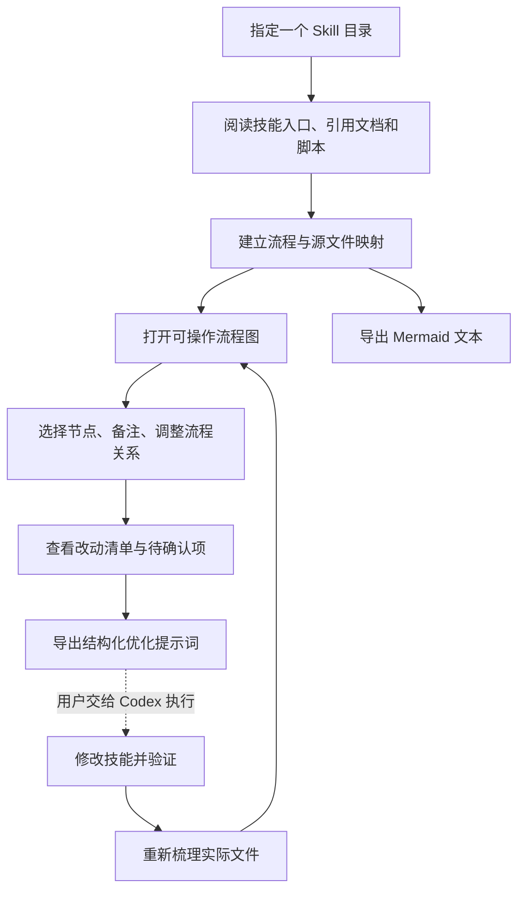

# Skill Graph：通过流程图理解与优化技能

状态：设计记录。首版主要功能现已实现，当前用法以 README 为准，历史验收见 validation-report.md。
日期：2026-09-25

## 目标和首版范围

用户希望在 Skill 或项目变复杂时，通过流程图理解整体结构，并将拖拽、备注等图上操作转化为专业、结构化的提示词，指导后续优化。

用户已确认：首版先把单个 Skill 做完整，再扩展到项目，并支持“Skill + 本地交互画布 → 导出提示词 → Codex 执行”的设计方向；实现前先调研 GitHub 并吸收适用思路。

用户最终得到的是：一张能追溯到源文件的流程图、一组明确的修改意图，以及可交给 Codex 执行的优化提示词。

## 方案比较与建议

| 方案 | 适用性 | 本场景的取舍 |
| --- | --- | --- |
| React Flow 交互画布 + Mermaid 导出 | 节点可嵌入表单，支持拖拽、连接和状态保存 | 推荐。适合把节点、备注、源文件和修改请求关联起来 |
| Mermaid 渲染 + 自建备注面板 | 文本图易保存；节点可绑定点击行为 | 适合以查看和备注为主的轻量版本；直接改连线和节点结构还需开发编辑能力 |
| Excalidraw 嵌入式白板 | 提供元素、状态变化等集成接口 | 适合自由画图；用于本需求时，仍要额外约束步骤、连线和源码映射的语义 |

以上取舍是针对本需求的设计判断。已核对的官方资料：

- [React Flow 自定义节点与交互](https://reactflow.dev/learn/customization/custom-nodes)
- [React Flow 保存与恢复](https://reactflow.dev/examples/interaction/save-and-restore)
- [Mermaid 节点交互](https://mermaid.js.org/syntax/flowchart.html#interaction)
- [Excalidraw 集成接口](https://docs.excalidraw.com/docs/@excalidraw/excalidraw/api/props/)

Mermaid 继续承担可读文本导出。内部使用结构化图数据保存来源、备注和修改状态；这些信息不能仅靠一份 Mermaid 文本完整表达。首版不承诺任意 Mermaid 文件的无损导入和双向转换。

GitHub 调研的具体依据见 [github-research.md](github-research.md)。优先借鉴 Atlas 的语义差异与提示词构造、Plannotator 的图元素批注定位、Diagrammer 的 Skill/画布文件交接。Agentation 和 Canvasdown 分别作为结构化反馈与操作协议的思路参考。本轮没有复制候选实现或加入第三方依赖。

## 使用闭环



1. **梳理。** Codex 读取目标 Skill、适用指令及相关资源，提取触发条件、阶段、判断分支、输入输出、异常与人工确认步骤。不能只把目录树转换成流程图。
2. **查看。** 首页先呈现主流程，子流程按需展开。节点详情展示职责、来源和关联资源；不把所有文件堆进一张图。
3. **表达修改。** 用户在具体节点或连线上添加备注，也可以增加步骤、标记移除、调整前后关系和分支条件。上述结构变化进入拟修改版本。
4. **导出。** 从原始流程与当前草稿的净差异生成改动清单，连同用户原话、来源证据、约束和验收要求生成提示词。撤销过的修改不进入最终请求。
5. **返回执行。** 首版允许复制提示词，或导出修改包后在 Codex 中交给 Skill 读取。提示词生成不依赖额外模型 API；语义细化可由当前 Codex 对话完成。
6. **更新。** 执行完成后重新读取实际文件，生成新的现状图。不能把编辑中的目标图直接标记为已实现。

## 画布应如何工作

建议采用三部分布局：左侧为流程层级与搜索，中间为画布，右侧为节点详情及备注；单独提供可展开的改动清单和提示词预览。

| 用户操作 | 系统解释 | 导出影响 |
| --- | --- | --- |
| 拖动节点位置、缩放、折叠 | 整理图的显示方式 | 保存布局，不生成技能修改要求 |
| 节点或连线备注 | 对指定对象表达意见 | 保留原话，附上下文 |
| 调整连线 | 建议修改顺序或分支 | 记录修改前后关系及分支条件 |
| 增加节点 | 建议增加一个步骤 | 记录职责、输入输出、插入位置；来源显示“拟新增” |
| 标记移除节点 | 建议移除流程步骤 | 列出上下游影响；不等同于删除对应文件 |
| 修改节点标题 | 默认修改显示名称 | 若希望改变职责，需通过备注或“修改步骤”明确表达 |
| 撤销、重做 | 修正编辑意图 | 根据最后状态导出净差异 |

首版画布上的连线只表达执行先后和条件分支。文件引用、调用或数据依赖放进详情，防止几种关系混在一起。并行执行不能从两个并列节点的位置推断；应有明确说明。

技能文本未明确顺序时，图中应标记“推断”或“顺序未约束”。自然语言 Skill 的流程图是对指令的解释，不代表每次真实运行都严格沿着同一条路径。

## 图与技能之间的联系

内部图数据至少包含以下信息：

| 对象 | 必需信息 |
| --- | --- |
| 分析基线 | Skill 标识、本机可解析的目标根目录、分析时间、已读文件范围、文件内容摘要 |
| 节点 | 稳定 ID、标题、职责、输入输出、所属阶段、来源定位、证据状态 |
| 来源定位 | 相对路径、章节标题或代码符号、辅助行号、短摘录 |
| 连线 | 稳定 ID、起点、终点、关系类型、条件与依据 |
| 编辑状态 | 节点位置、展开状态，与流程语义分开保存 |
| 修改请求 | 目标 ID、操作类型、前后状态、用户原始备注、约束、待确认项 |

节点 ID 应保存并复用；不能因为改标题或移动位置就变化。重新分析时，通过旧映射和来源匹配保留 ID；无法可靠匹配的节点及备注进入待重新关联列表。

批注保存图 ID、基线版本、目标节点或连线 ID、当时的标题与来源摘录。节点删除、图重绘或来源变化后，失去定位的批注仍应可见；标题相同但身份不明时，不自动把批注转移到另一个节点。

来源是多对多关系：一个步骤可能涉及多个文件，同一文件也可能支持多个步骤。行号只能辅助定位，不能作为唯一标识。

修改包携带目标根目录及根目录内的相对路径。另一任务读取时先验证目标；跨机器或根目录不可解析时，由用户指定新位置并校验文件摘要，不能只凭同名文件猜测目标。

分析保留当前事实，画布编辑保存期望变化。执行提示词前核对相关源文件是否变化；如基线已过期，先重新分析受影响部分并核对备注归属。

## 提示词如何变得可执行

输出包含：任务目标、目标 Skill 与基线、来源定位、当前行为、用户原话、期望变化、影响范围、必须保留的行为、验收条件、待确认项、执行及回报要求。

专业性来自上下文和可验证要求，而非自动增加术语。用户只写“优化这里”时，不能凭空补成指定算法、重试次数或性能目标。可以提出建议并标注为建议；影响实现的歧义保留为待确认项。

以下是示意，不代表已分析某个真实 Skill：

```text
任务：为“读取文件”步骤补充失败处理。

定位：节点 read-input；目标 Skill 的 SKILL.md 中“读取输入”章节。
执行前重新核对该章节和关联脚本，确认与生成流程图时的基线一致。

用户原话：文件不存在时先提示我重新选，不要继续生成空报告。

期望行为：
1. 文件不存在时，说明问题并请求重新提供文件。
2. 收到有效文件前，不进入报告生成步骤。
3. 正常文件仍沿用当前成功路径和报告格式。

影响范围：读取输入节点、读取失败分支及其与报告生成节点的连接。
先检查关联实现，仅修改落实该行为所必需的内容。

验收：
- 不存在的文件不会触发空报告生成。
- 提供有效文件后可以继续。
- 原有有效输入的输出格式保持一致。

完成后说明修改文件、验证结果及尚未解决的问题，并重新生成实际流程图。
```

模板应区分来源已证实的行为、用户要求和系统建议。即使由另一个 Codex 任务执行，提示词也应携带足够的定位信息，不依赖当前聊天记忆。

批注可标记为“修改要求”“问题”或“建议”。提问不会自动变为代码修改任务；验收要求由用户意见和已核实的上下文形成，未被用户确定的建议应单独列出。

导出采用同一份修改请求数据，同时生成机器可读 JSON 和人可读 Markdown 提示词。提示词中的“定位”必须指向目标 Skill 文件；流程图的 Mermaid 行号只作为辅助证据，不能替代 Skill 源码定位。

比较当前草稿与分析基线时，只将步骤职责、输入输出、连线和条件等语义变化纳入变更清单。坐标、视口、折叠和选中状态单独保存。批注原文与图的净差异并列保留，避免把反复拖动和撤销的每个中间动作都交给执行者。

## 交付形态与首版边界

建议技能名称为 `skill-graph`。技能包包括：

- `SKILL.md`：何时触发、如何分析、如何生成与回读修改包。
- `references/`：图数据约定、来源映射规则和提示词模板。
- `scripts/`：检查数据、生成导出物等确定性辅助功能。
- `assets/`：可复用的本地交互画布资源。

这里保留设计阶段的拟交付结构；实际目录与启动命令以仓库 README 为准。

每次分析生成独立的图数据、Mermaid 和修改包，避免覆盖目标 Skill。画布保存后应能恢复节点位置、备注、草稿和基线关联。首版使用本地页面和文件导入导出衔接；浏览器不能被假定为能任意读写本地 Skill，也不能被假定为能直接给 Codex 发送执行指令。

图文件使用明确的协议版本，源码映射、基线和修改请求是协议中的正式字段。保存、导入和校验都要保持这些字段；不依赖第三方图编辑器对未知字段的隐式保留。

梳理由 Codex 完成，不使用关键词扫描伪装完整的架构理解。无法读取的文件、未覆盖的外部依赖和证据不足的分支应明确显示，不能声称已经完整梳理。

首版重点是可操作的理解与修改请求生成。后续再扩展到项目级的模块视图和调用视图，以及执行后的版本对比。多人协作、云端账号和自动执行引擎不属于这次需求的必要部分。

## 验收与验证方式

交付时用一个包含引用文件、脚本、条件分支和失败路径的真实 Skill 验证，而非仅用预置演示图。

1. **看得懂且有依据：** 主要阶段、成功和失败路径可追溯至真实文件；未确定关系明确标注。
2. **改动意图准确：** 布局拖拽不产生逻辑修改；节点备注和连线调整准确出现在导出请求里。
3. **保存有效：** 关闭再打开，以及导出后重新导入时，图、备注、源码映射和基线关系均可恢复；撤销后的操作不被导出，失联批注不会消失。
4. **能交给另一任务：** 独立执行者仅凭修改包能定位目标；未知信息不会被当成事实。
5. **版本有区分：** 源文件变化后能识别过期映射；完成修改后展示从真实文件重新生成的图。

实现验证应覆盖图差异、定位与版本核对、数据往返、提示词生成，以及真实浏览器中的拖拽、备注、连线、撤销和导出。设计阶段完成了方案、官方能力核对和 GitHub 关键源码调研；后续实现验证结果记录在 validation-report.md。
